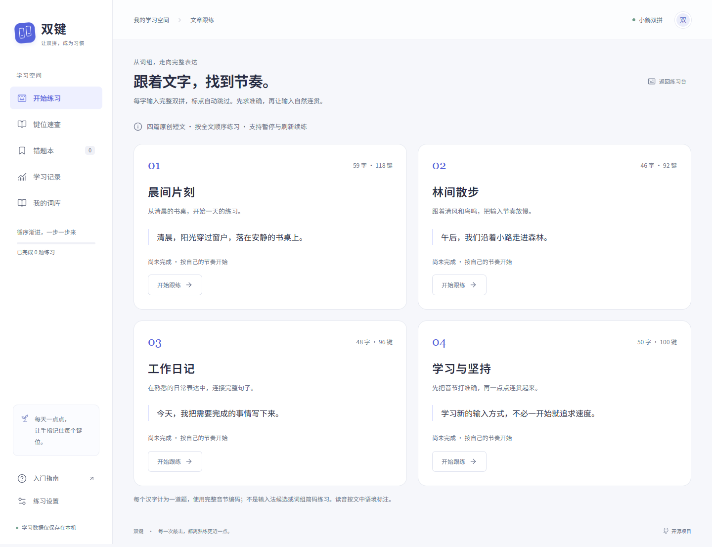
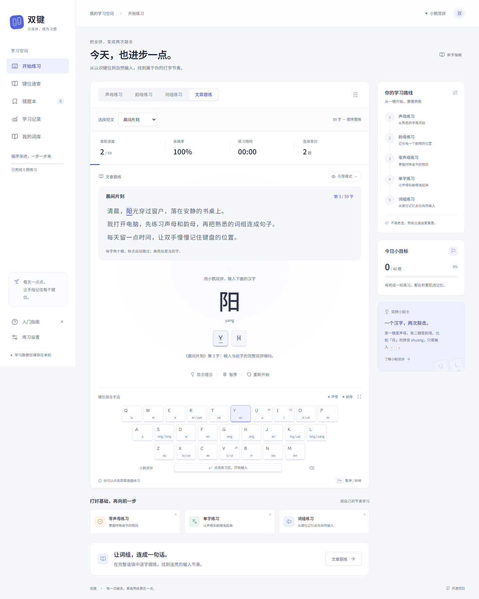

# 文章跟练验证记录

日期：2026-10-17。基线为 `1689c32`，原有 27 项单元测试通过，工作区无修改。

## 验证结果

- `npm test`：31 项通过。
- `npm run test:e2e`：34 项通过，包含原有 28 项回归与 6 项文章流程。
- `npm run build`：TypeScript 检查与 Vite 生产构建通过。
- `npm run format:check`：通过。
- 375、768、1440 像素和 812 × 375 横屏均无文档横向溢出；原文当前字保持在滚动区内。
- 本地截图检查：目录、桌面跟练、手机跟练；浏览器无未捕获页面错误。
- 本轮无新增依赖，无现有数据迁移或版本号变更。旧 v1 备份兼容测试仍通过。

## 需求与证据

| 需求                                       | 精确测试名称                                                                                    |
| ------------------------------------------ | ----------------------------------------------------------------------------------------------- |
| 原文、标点、字数及手动读音对齐             | `original passages retain punctuation and align each Han character with a two-key reading`      |
| 四篇独立范围与非法范围处理                 | `article groups select one complete passage without crossing its boundary`                      |
| 超过 50 题恢复且拒绝乱序、缺字和跨文章内容 | `article snapshots restore more than fifty questions in exact full-text order`                  |
| 备份题目、文章 ID、全文题数及记录冲突校验  | `article backup metadata and contextual mistakes survive a canonical round-trip`                |
| 五项主导航、目录、顺序输入与标点跳过       | `catalog starts complete sequential text and automatically skips punctuation`                   |
| 半音节恢复、暂停、目录继续、范围切换确认   | `refresh and catalog continuation preserve partial article input and reject cancelled switches` |
| 59 字全文完成、历史标题、导出及幂等导入    | `full article completion records its title and exports an importable backup exactly once`       |
| 错题带原文位置且复习后移除                 | `article mistakes keep their original character and can be cleared through review`              |
| 明确切换文章后重置且不记录放弃轮次         | `catalog confirmation starts a different article without counting an abandoned round`           |
| 手机、平板、桌面和横屏的排版与当前字可见性 | `article reader stays usable without horizontal overflow on mobile tablet and desktop`          |

## 截图

## 已知边界

短文为内置的四篇原创内容，暂不支持自定义文章。每字计为一道题，统计沿用有效按键口径。主学习路线的五个基础阶段保持原样，文章表现可在目录及历史查看。浏览器自动化使用 Chromium，未执行真实 iOS / Android 设备测试。
