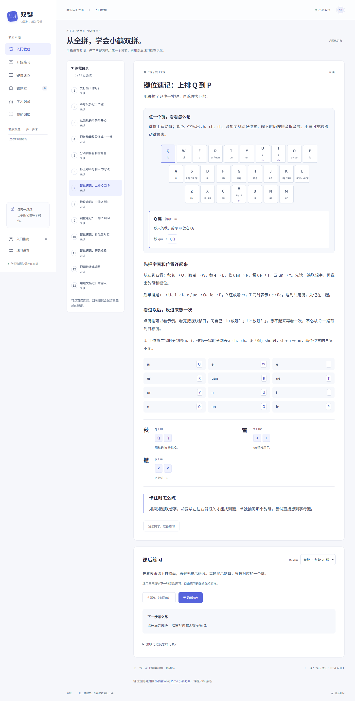
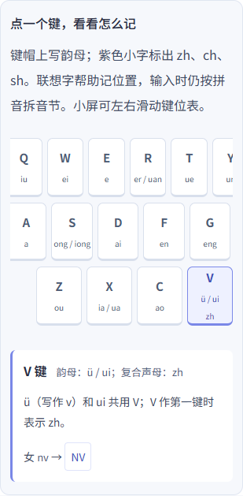

# 键位表速记课程验证

日期：2026-10-24。基线 `c101c7d`，原有 38 项单元测试通过，工作区干净。

## 范围

在原有八课中增加五节速记课，按上排、中排、下排、易混键和整表安排。原课程 ID 保持不变。键位表直接使用现有小鹤映射，联想字的编码逐项校验；文字说明沿用 humanizer 的朴素写法，不承诺固定记忆时间。

整表每轮 33 题，规范韵母各出现一次，ue / üe 作为一项。恢复轮次时检查数量、重复题和范围；备份支持 33 题记录。无提示课程验收隐藏屏幕键盘上的声韵母文字及辅助阅读提示，字母按钮仍可输入。

## 验证结果

- 41 项单元测试与 44 项浏览器测试全部通过。
- TypeScript、生产构建、Prettier 与 Diff 检查通过。
- 375、768、1440 像素下页面无横向溢出；小屏键位表在自身区域内滚动。
- 截图与浏览器检查无未捕获页面异常。
- 无新增依赖，无持久化版本升级；旧课程、旧记录、旧快照继续兼容。

| 需求                                      | 精确测试名称                                                                                        |
| ----------------------------------------- | --------------------------------------------------------------------------------------------------- |
| 26 键、全部规范韵母及联想字编码正确       | `memory keyboard covers every canonical final once and all mnemonic words encode correctly`         |
| 分排范围与整表每项一次、不受题数限制      | `row homework stays within its keyboard row while the full test visits every final exactly once`    |
| 快照、备份、旧成就与非法题数 / 重复题拒绝 | `full-map snapshots and backups preserve achievements but reject truncated or repeated finals`      |
| 点击、键盘操作、共用键与复合声母说明      | `memory table exposes all letter keys with mnemonic details and keyboard selection`                 |
| 无提示、刷新续练、33 题结算和两轮通过     | `row homework is scoped and a full-map check survives refresh then records all thirty-three finals` |
| 手机、平板、桌面的排版与分排练习范围      | `memory map scrolls within the reading surface on phones without page overflow`                     |

映射核对：[Rime 官方小鹤方案](https://github.com/rime/rime-double-pinyin/blob/master/double_pinyin_flypy.schema.yaml)。联想文字为本站教学提示。浏览器验证使用 Chromium，未执行真实手机设备测试。
