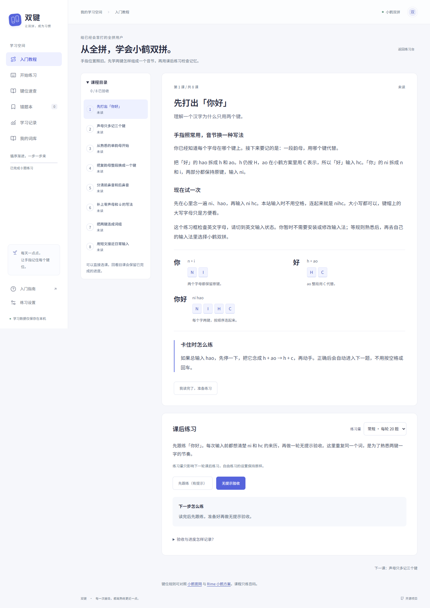
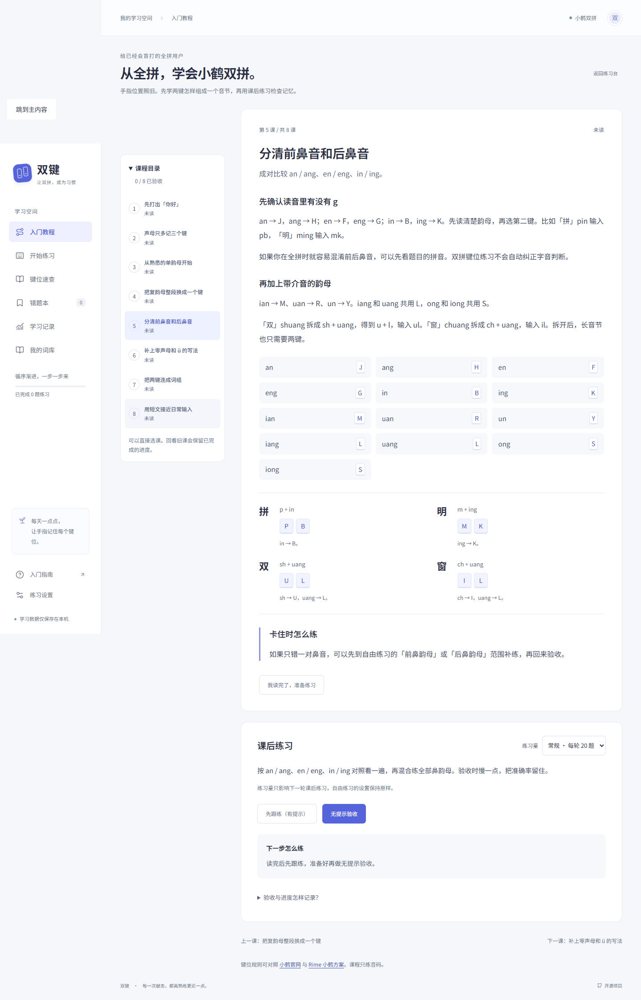

# 入门课程与 Pages 验证

日期：2026-10-18。起点为 `c3f5799`，工作区干净，原有 31 项单元测试通过。

## 结果

- 38 项单元测试、41 项浏览器测试通过，保留原有练习、词库、文章、备份和刷新恢复回归。
- TypeScript、生产构建、Prettier 检查通过，无新增运行时依赖。
- 在生产预览 `/shuangpin/` 下验证教程、课后练习、刷新与 favicon，HTTP 200，无资源加载失败或页面异常。
- 375 / 768 / 1440 像素及 812 × 375 横屏无文档横向溢出。正文至少 16px，六项导航均可触达，课程切换和练习开始后焦点可用。
- 课程正文按 humanizer 做嵌入式复核：直接说明动作、具体例子和错误恢复，不重复指法教学，不承诺固定学习周期或速度。95% 与连续两轮明确作为本站建议。

## 需求与证据

| 需求                                            | 精确测试名称                                                                                         |
| ----------------------------------------------- | ---------------------------------------------------------------------------------------------------- |
| 八课示例编码、课程范围与三档题数                | `course examples teach verified Flypy codes and every task is a canonical nonempty question`         |
| 按实际准确率判断两轮验收，包含 94.5% / 95% 边界 | `assessment requires the latest two unassisted checks at the raw ninety-five percent boundary`       |
| 跟练、提示、其他课次和失败轮次不冒充验收通过    | `guided, assisted, unrelated and interrupted qualifying streaks cannot pass a course`                |
| 非法课程、模式、练习量和重复标记拒绝导入        | `course state validates known IDs, unique progress lists, pace and assistance`                       |
| 旧备份兼容、阅读和通过进度合并、位置设置选择    | `legacy backups gain empty course progress and merges preserve achievements and settings choices`    |
| 课程记录校验与同编号冲突                        | `course records round-trip and reject metadata conflicts or impossible homework totals`              |
| 特殊规则混合题、短文原序与提示状态恢复校验      | `mixed special-rule homework resumes while forged scope, mode and assistance are rejected`           |
| 阅读与验收区分，练习量不改自由练习              | `tutorial separates reading from assessment and saves pace without changing free practice settings`  |
| 两轮真实盲打通过、之后回练保留标记              | `two independent blind checks pass a lesson and preserve achievement when returning to old lessons`  |
| 查看提示后刷新、继续、记录和跟练不算通过        | `assisted checks resume paused with the same scope and never count as blind passes`                  |
| 回看课程标记帮助，取消切换保留半音节            | `reading a different lesson and cancelling homework protects the unfinished round`                   |
| 混合零声母 / ü 的课后练习与完整 59 字短文       | `special-rule homework mixes canonical question types and sentence homework keeps the whole article` |
| 课程备份与存储失败时不伪造已读状态              | `course progress survives backup import and failed storage does not fake a read marker`              |
| 响应式排版、正文、导航、键盘焦点                | `tutorial text, six navigation items and homework remain accessible across viewport sizes`           |

## 截图

## 发布与边界

GitHub Pages 采用官方 `configure-pages`、`upload-pages-artifact` 和 `deploy-pages`，仅默认分支通过 Verify 后发布；PR 只验证。相对资源路径兼容 Pages 仓库目录及 Sites 根路径。Pages 已启用 Actions 构建来源。

课程进度仍在当前浏览器保存，两个站点不自动同步，通过 JSON 转移。验收只记录站内提示和资料查阅，无法判断是否查看了站外资料。未执行真实手机设备或多浏览器兼容测试。
